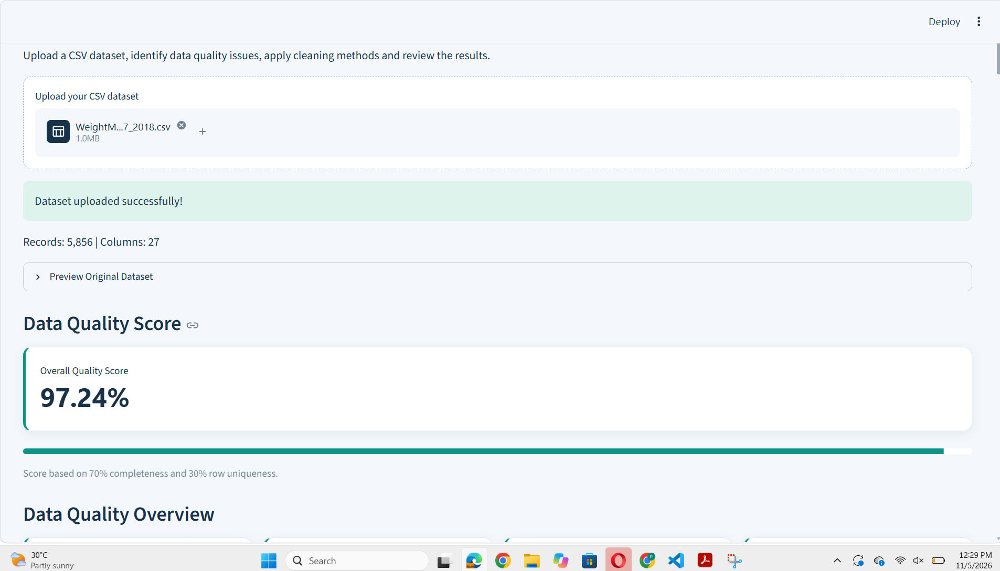
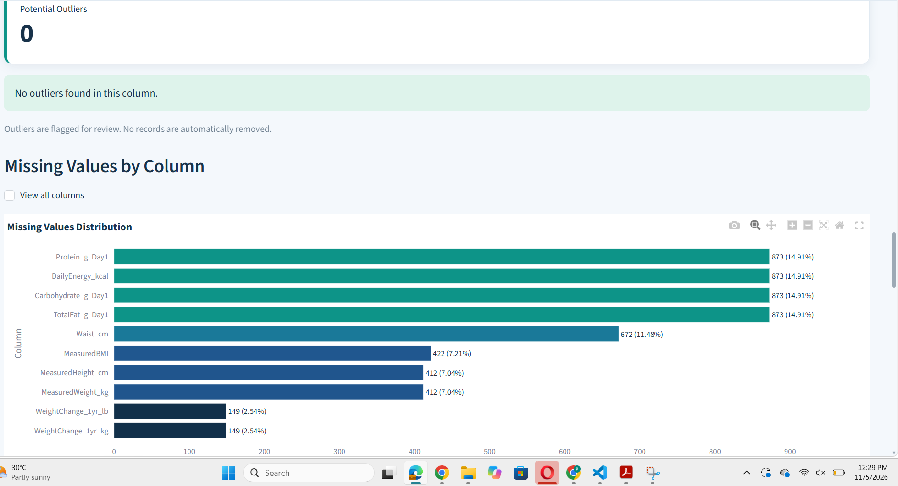

# Universal Data Quality System

A Python and Streamlit-based web application designed to automate data quality assessment, validation, cleaning, visualization, and reporting.

## Project Overview

The Universal Data Quality System helps users identify potential data quality issues in CSV datasets, apply selected cleaning operations, and evaluate the results through interactive visualizations and reports.

The application supports transparent data cleaning by maintaining an audit log of recorded changes.

## Key Features

- **Data Profiling:** Analyze dataset dimensions, missing values, duplicates, and column data types.
- **Data Quality Score:** Calculate an illustrative quality score based on completeness (70%) and row uniqueness (30%).
- **Data Validation:** Flag potentially invalid emails, dates, negative numeric values, and duplicate IDs.
- **Validation Filtering:** Filter detected issues by issue type.
- **Outlier Detection:** Identify potential numeric outliers using the Interquartile Range (IQR) method.
- **Smart Missing Value Cleaning:** Apply Mean, Median, Mode, Unknown, or Keep Missing options.
- **Duplicate Removal:** Optionally remove exact duplicate rows.
- **Whitespace Cleaning:** Remove unnecessary leading and trailing spaces.
- **Before and After Analysis:** Compare data quality metrics and numeric distributions.
- **Cleaning Audit Log:** Track recorded cleaning changes.
- **Report Generation:** Export cleaned datasets, quality reports, audit logs, and PDF assessment reports.

## Technologies Used

- Python
- Pandas
- Streamlit
- Plotly
- ReportLab
- HTML/CSS

## Project Structure

```text
Data-Quality-Automation/
├── universal_app.py
├── universal_cleaner.py
├── pdf_report.py
├── styles.css
├── requirements.txt
└── README.md
```

## Installation and Setup

**1. Clone the repository**

```bash
git clone https://github.com/pramudinawanjana1978-coder/Universal-Data-Quality-System.git
```

**2. Navigate to the project folder**

```bash
cd Universal-Data-Quality-System
```

**3. Install the required packages**

```bash
python -m pip install -r requirements.txt
```

**4. Run the Streamlit application**

```bash
python -m streamlit run universal_app.py
```

## How to Use

1. Upload a CSV dataset.
2. Review the dataset overview and quality score.
3. Examine validation issues and potential outliers.
4. Select suitable cleaning options.
5. Run the cleaning process.
6. Compare the original and cleaned datasets.
7. Download the cleaned dataset and assessment reports.

## Important Notes

- The quality score is an illustrative metric, not an industry-standard certification.
- Flagged negative values and statistical outliers are not necessarily errors.
- Cleaning operations should be reviewed before using the results for business decisions.
- The application does not automatically delete potential outliers.

## Project Purpose

This project was developed to demonstrate practical skills in Python programming, data validation, data cleaning, exploratory data analysis, interactive visualization, and automated reporting.


## Application Screenshots

### Dashboard Overview



### Missing Values Analysis




## Author

Pramudi Nawanjana

GitHub: https://github.com/pramudinawanjana1978-coder
